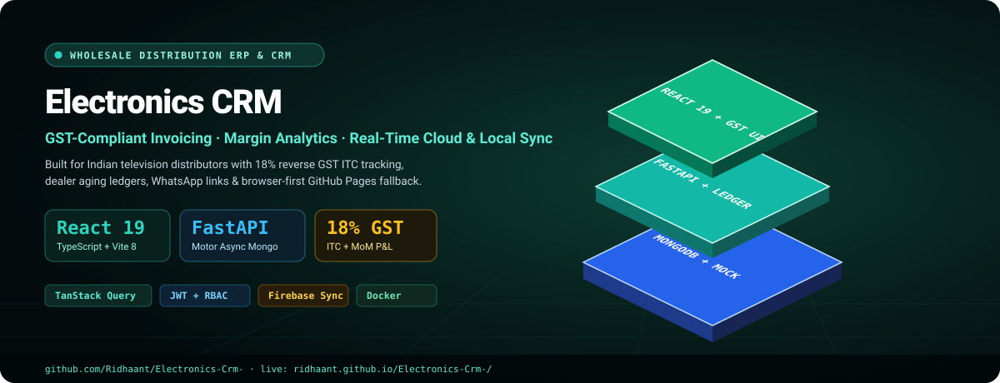
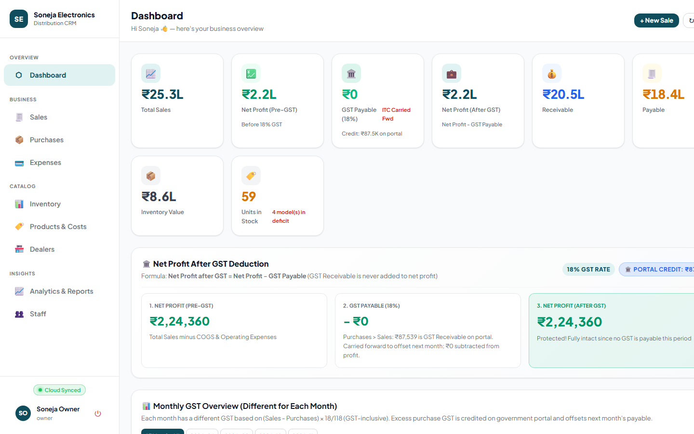
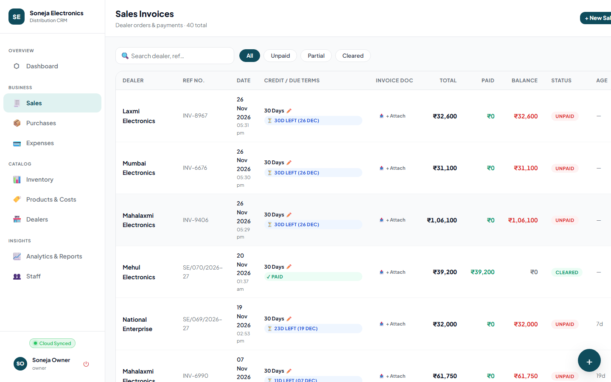
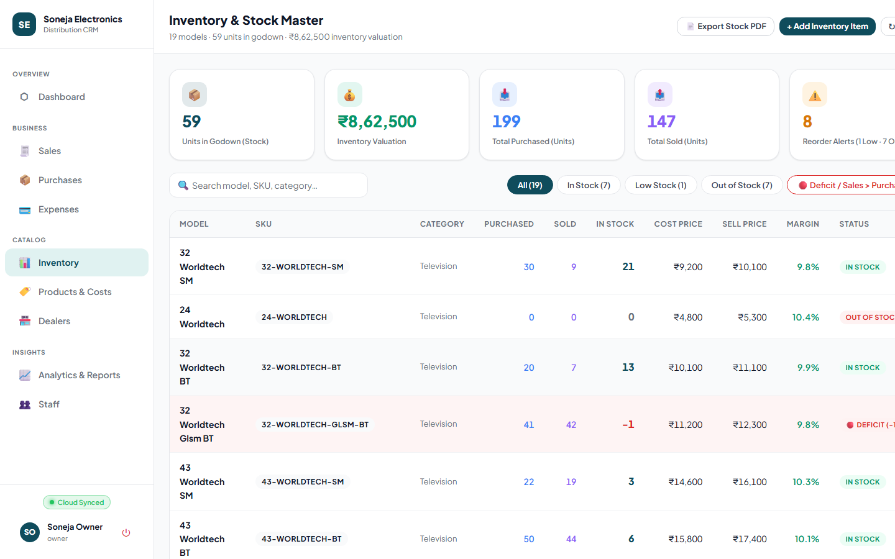
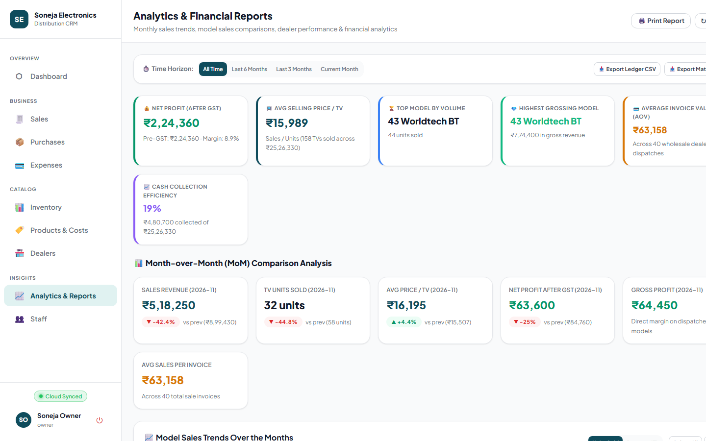
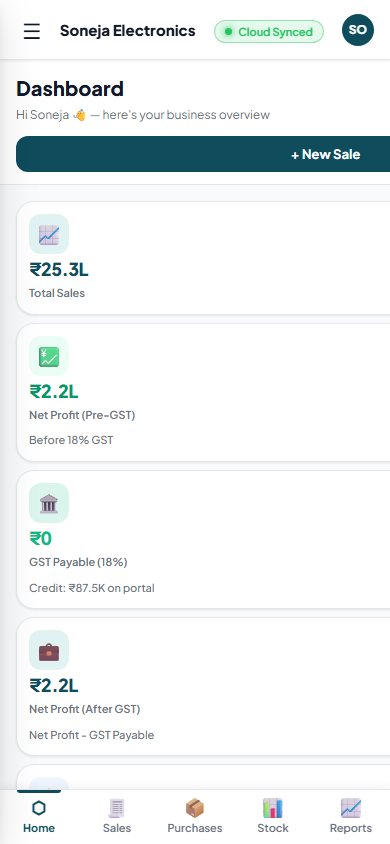
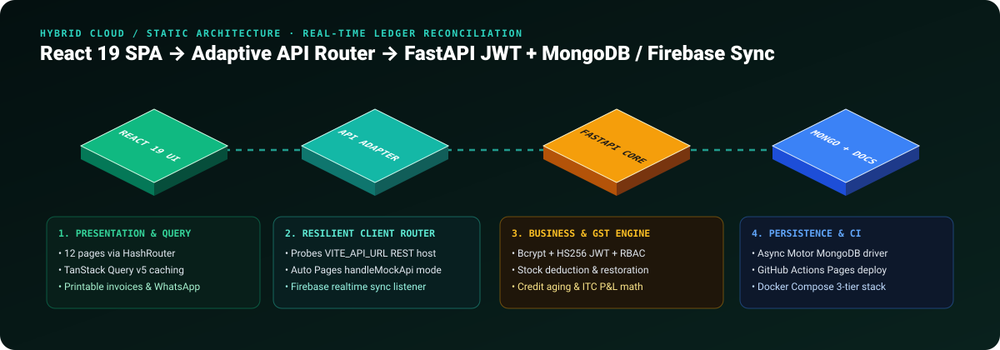

<p align="center">
  
</p>

<h1 align="center">Soneja Electronics — Distribution CRM &amp; Inventory Master</h1>

<p align="center">
  <strong>Full-stack Indian wholesale ERP &amp; distribution CRM featuring 18% GST Input Tax Credit (ITC) deduction math, automatic stock ledger reconciliation, dealer credit aging, and an offline-capable GitHub Pages demo.</strong>
</p>

<p align="center">
  <a href="https://ridhaant.github.io/Electronics-Crm-/">
    
  </a>
  
  
  
</p>

> **Live Demo (`https://ridhaant.github.io/Electronics-Crm-/`)**: Log in immediately using `owner@soneja.com` / `Soneja@123`. When hosted statically without `VITE_API_URL`, [`frontend/src/api.ts`](frontend/src/api.ts) transparently routes all queries to the browser-resident `handleMockApi` ledger store.

---

## Live Application Screenshots

Captured via Chromium Playwright against the built static SPA (`1440×900` desktop & `390×844` mobile):

<table>
  <tr>
    <td width="50%" valign="top">
      <a href="docs/screenshots/01_dashboard.png"></a>
      <br />
      <strong>1. Executive Dashboard &amp; Net Profit After GST</strong>
      <br />
      <sub>Live KPIs tracking ₹25.3L total sales, ₹20.5L receivables, ₹18.4L payables, ₹87.5K ITC credit carried forward, and automated pre/post-GST profit protection.</sub>
    </td>
    <td width="50%" valign="top">
      <a href="docs/screenshots/02_sales_invoicing.png"></a>
      <br />
      <strong>2. Wholesale Sales Invoicing &amp; Credit Terms</strong>
      <br />
      <sub>40 seeded dealer invoices with live settlement filters (<code>All</code> / <code>Unpaid</code> / <code>Partial</code> / <code>Cleared</code>), 30-day due countdowns, and invoice attachments.</sub>
    </td>
  </tr>
  <tr>
    <td width="50%" valign="top">
      <a href="docs/screenshots/03_inventory_margins.png"></a>
      <br />
      <strong>3. Inventory Master &amp; Margin Reconciliation</strong>
      <br />
      <sub>Per-model Worldtech TV stock ledger (purchased − sold), live godown valuation (₹8,62,500), deficit alerts, and automated unit gross margin %.</sub>
    </td>
    <td width="50%" valign="top">
      <a href="docs/screenshots/04_reports_pnl.png"></a>
      <br />
      <strong>4. P&amp;L Waterfall &amp; MoM Performance Analytics</strong>
      <br />
      <sub>Top-selling model rankings, average invoice value, collection efficiency, CSV ledger export, and month-over-month deltas.</sub>
    </td>
  </tr>
  <tr>
    <td colspan="2" align="center">
      <a href="docs/screenshots/05_mobile_crm.png"></a>
      <br />
      <strong>5. Responsive Handheld UI (<code>390×844</code> with Sticky Bottom Navigation)</strong>
    </td>
  </tr>
</table>

---

## 3D Hybrid System Architecture

<p align="center">
  
</p>

### Engineering Highlights
- **Graceful Cloud-to-Local Resilience (`frontend/src/api.ts`, `firebaseSync.ts`):** Probes `VITE_API_URL/api/*` when configured, supports optional Firebase real-time sync across distributed tablets, and falls back deterministically to `handleMockApi` when offline or served from GitHub Pages.
- **Order Settlement & Credit Aging Serializer (`backend/server.py`):** Computes cleared/partial/unpaid status dynamically from multi-tranche payment arrays (`balance`, `due_date`, `is_due_passed`, `age_days`) and reconciles `opening_stock + purchased - sold` atomically across 1,386 lines of FastAPI + Motor async endpoints.
- **Role-Based Access Control:** Separate owner vs staff permissions for managing cost sheets, P&L waterfalls, and staff activation using Passlib bcrypt hashes and HS256 JWT tokens.

---

## Program Structure

```text
Electronics-Crm-/
├── .github/workflows/deploy.yml   # Automated GitHub Pages workflow publishing ./docs
├── backend/
│   ├── server.py                  # FastAPI + Motor async MongoDB API, JWT RBAC & settlement logic (1,386 lines)
│   ├── scripts/add_sales_orders.py# Wholesale order seed utility
│   └── tests/                     # test_server_logic.py (6/6 passing) + test_soneja_api.py
├── frontend/
│   ├── src/
│   │   ├── App.tsx                # HashRouter routes, TanStack Query v5 & Firebase real-time sync
│   │   ├── api.ts & auth.tsx      # Adaptive REST + GitHub Pages mock adapter + JWT context
│   │   ├── *Modal.tsx             # CloudSync, InvoiceViewer, InvoiceUpload & WhatsApp modals
│   │   └── pages/                 # Dashboard, OrderForm/List/Detail, Inventory, Products, Dealers, Expenses, Reports, Staff, Billing
│   ├── tests_crm_logic.mjs        # Frontend CRM calculation test script
│   └── sync-docs.js               # Syncs Vite build output cleanly into ./docs for GitHub Pages
├── docker-compose.yml             # 3-container orchestration (MongoDB + FastAPI + Nginx web)
└── docs/
    ├── index.html & assets/       # Prebuilt GitHub Pages production SPA
    ├── diagrams/                  # Animated 3D isometric SVGs (crm-3d-hero.svg, crm-architecture-3d.svg)
    └── screenshots/               # 5 live Playwright captures of Dashboard, Sales, Inventory, Reports & Mobile UI
```

---

## Verification & Quick Start

```bash
# Verified backend unit logic tests (6 / 6 passing in 5.36s):
PYTHONPATH=backend pytest backend/tests/test_server_logic.py -v

# Run full Docker Compose stack (MongoDB + FastAPI + Frontend):
docker-compose up --build -d

# Or run Frontend standalone with built-in mock adapter:
cd frontend && npm install && npm run dev
```
